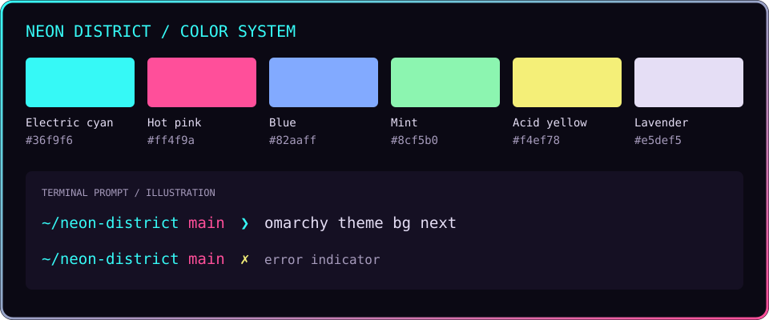
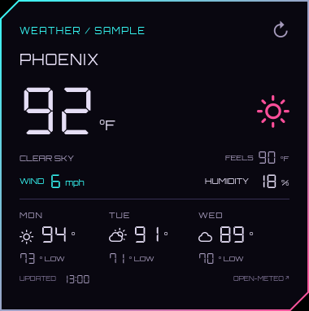
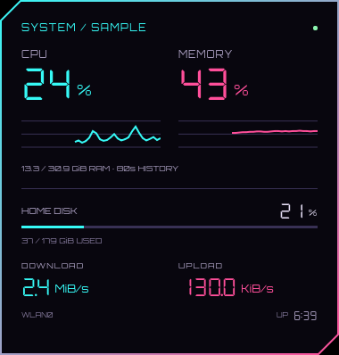
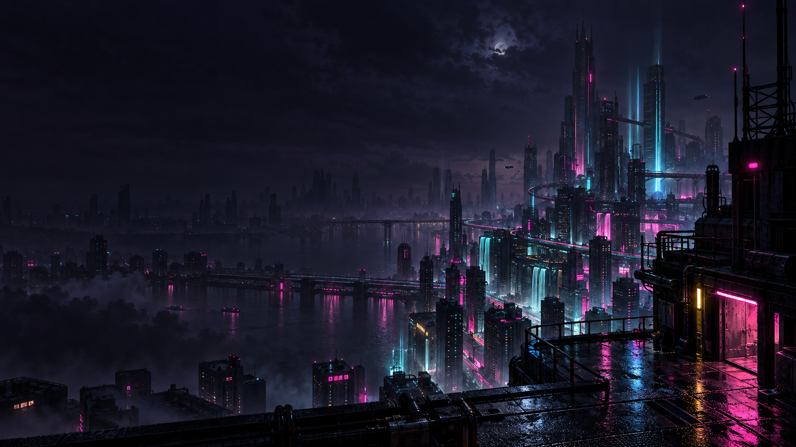
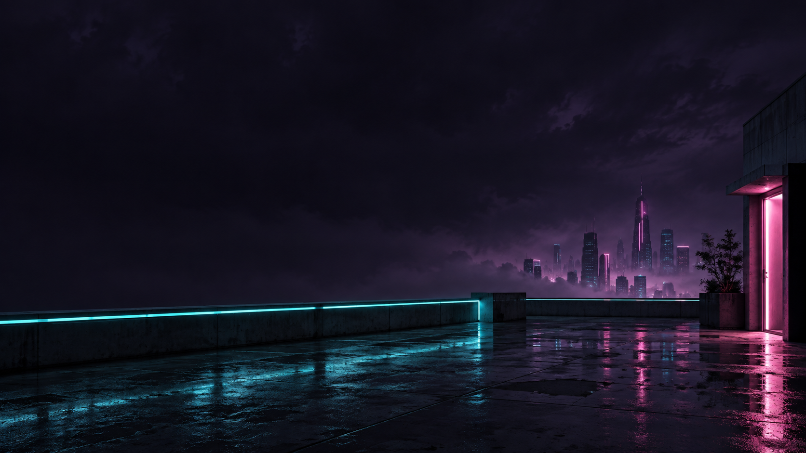

# Neon District

A cyberpunk Omarchy theme: near-black violet, electric cyan, hot pink, and pale lavender text. Includes two custom cyberpunk wallpapers.


*Styled wallpaper preview illustrating the gradient window border. Theme accents: electric cyan `#36f9f6`, hot pink `#ff4f9a`, and near-black violet `#0b0914`.*

## Install

Requires Python 3 and an Omarchy installation using `colors.toml` and the Quickshell shell. From a complete checkout:

```bash
python3 install.py --dry-run
python3 install.py --apply
```

The installer backs up an existing theme before changes and installs only theme assets. Optional prompt and window effects remain separate.

See [INSTALL.md](INSTALL.md) for verification, staging, and rollback. Coding agents should read [AGENTS.md](AGENTS.md).

## Palette



The terminal sample is an illustration, not a desktop screenshot. The swatches use the values in `colors.toml`.

## Desktop widgets — Weather



The first desktop widget uses **chamfered top-left and bottom-right corners**, a cyan-to-pink gradient border, and a dark translucent surface. Angular **Orbitron** labels and **DSEG7 Classic** seven-segment numbers give it a digital instrument-panel look. The screenshot above uses labeled sample data.

It shows current conditions, feels-like temperature, wind, humidity, and a three-day forecast. It sits behind application windows, refreshes every 15 minutes, and marks retained readings as stale when an update fails. Click the refresh arrow to retry.

```bash
python3 install.py --weather-widget --dry-run
python3 install.py --weather-widget
omarchy-shell shell rescanPlugins
omarchy plugin enable neon-district.weather
```

Network access defaults to off. To retrieve weather, explicitly allow sending the location coordinates already stored by Omarchy to [Open-Meteo](https://open-meteo.com/) by adding `"allowNetwork": true` to the widget's entry in `~/.config/omarchy/shell.json`. Merge these fields into the existing entry; do not replace the rest of the configuration:

```json
{
  "id": "neon-district.weather",
  "allowNetwork": true,
  "unit": "imperial",
  "x": 28,
  "y": 72
}
```

The widget surface defaults to **82% opacity**; `"backgroundOpacity": 0.82` in the same plugin entry adjusts the fill independently of the border and text (range 0.1–1.0).

For backdrop blur, copy the optional compositor settings and load them at the end of `~/.config/hypr/hyprland.lua`:

```bash
cp extras/neon-widgets.lua ~/.config/hypr/neon-widgets.lua
```

```lua
require("hypr.neon-widgets")
```

Then run `hyprctl reload` and `hyprctl configerrors`. This enables Hyprland's global blur engine (size 6, two passes) and adds a [layer rule](https://wiki.hypr.land/configuring/core/rules/layer-rules/) for the weather widget. Transparent chamfer corners are excluded; text and borders stay sharp. The global blur settings also affect other surfaces already eligible for blur. Remove the `require` line and reload to undo. The theme installer does not edit your Hyprland configuration automatically.

If the glass effect is hard to see, try `"backgroundOpacity": 0.70`. Blur is most visible over detailed wallpaper; the dark sky in the upper-left can look almost solid. Omarchy's open scratchpad also dims the desktop behind it. Close the scratchpad to judge the widget's normal appearance. A configuration check confirms the rule is accepted, but a visual check is still needed to confirm the effect.

`unit` accepts `metric` or `imperial`; when omitted, an `en_US` locale uses Fahrenheit and other locales use Celsius. Optional `monitor` selects an output name (for example `eDP-1`); otherwise the first screen is used. Coordinates are logical pixels from the upper-left. Set your city in Omarchy's existing weather panel. No API key is needed; weather data comes from [Open-Meteo's forecast API](https://open-meteo.com/en/docs).

After updating plugin code, use `omarchy restart shell` if the running shell retains the old version. Disabling and re-enabling a plugin may reset its per-plugin settings; review the entry afterward.

Check live status with `omarchy-shell neon-weather status` or refresh with `omarchy-shell neon-weather refresh`. Disable with `omarchy plugin disable neon-district.weather`. `widgets/neon-district.weather/ChamferFrame.qml` is the reusable frame for future widgets. `WeatherCard.qml` is independent of the desktop host, making offline preview/testing possible. `WidgetTypography.qml` and `DigitalReadout.qml` provide reusable typography for future widgets. Both fonts are bundled locally with their SIL Open Font License files; no system-wide font change or runtime font download is required. See [font sources](widgets/neon-district.weather/FONT-SOURCES.txt).

## Desktop widgets — System monitor



CPU and memory percentages, 80-second activity graphs, home-filesystem disk usage, download/upload speeds, and uptime. All readings come from local Linux counters every two seconds; this widget makes no network requests and needs no extra Python packages.

```bash
python3 install.py --system-widget --dry-run
python3 install.py --system-widget
omarchy-shell shell rescanPlugins
omarchy plugin enable neon-district.system
```

It aligns below the weather widget and inherits its monitor, horizontal position, and background opacity when not configured separately. Without a weather entry, it defaults to the right side. On smaller displays, set explicit coordinates to avoid overlap. To enable blur, use the updated `extras/neon-widgets.lua` from the weather setup above; its rule covers both widgets.

Optional fields in the `neon-district.system` plugin entry in `~/.config/omarchy/shell.json`:

| Field | Purpose |
| --- | --- |
| `x`, `y` | Position in logical pixels; clamped inside the chosen screen |
| `monitor` | Output name, such as `eDP-1` |
| `backgroundOpacity` | Fill opacity, from 0.1 to 1.0 |
| `diskPath` | Path on the filesystem to measure; defaults to your home directory |
| `interface` | Network interface override; otherwise follows the default route, with active physical interface fallback |

Network rates are **bytes per second**, shown as KiB/s or MiB/s. The first rate/CPU sample is blank while counters establish a baseline. Changing interfaces or resetting counters does not produce a false speed spike. RAM usage excludes available/reclaimable memory; disk percentage follows `df`-style available-space accounting. Uptime is shown as hours:minutes. CPU and memory graphs use a fixed 0–100% scale.

Check it with `omarchy-shell neon-system status`. Disable with `omarchy plugin disable neon-district.system`. The frame, fonts, and numeric components are packaged identically to the weather widget so either plugin can be installed independently.

## Wallpapers

| Neon District | After Hours |
| --- | --- |
| [](backgrounds/neon-district.png) | [](backgrounds/after-hours.png) |
| Detailed rainy cityscape | Quieter rooftop with more dark space |

Cycle between them with `omarchy theme bg next` while Neon District is active.

## Lock screen and terminal prompt

The theme includes cyan lock-screen text, a pink password border, and yellow error feedback. With Lock Explorer's **Editorial** layout, this gives an oversized cyan clock over the city wallpaper. The stock lock screen also uses these colors; layout depends on your lock plugin.

An optional Starship prompt is included at `extras/starship.toml`: cyan paths, pink Git branches/status, and yellow command-error indicators. It uses terminal ANSI colors, so it adapts when you switch themes. Back up your existing prompt before installing:

```bash
cp ~/.config/starship.toml ~/.config/starship.toml.bak.$(date +%s)
cp extras/starship.toml ~/.config/starship.toml
```

The prompt appears on the next shell prompt redraw. Installing the theme alone does not replace your Starship configuration.

## Optional violet shadows and border compatibility

`extras/neon-district.lua` adds soft violet shadows and makes the theme's cyan/pink borders take precedence over local border colors. If `hypr-shiny-border` is already loaded, it also recolors that effect while retaining its animation settings. The overrides only apply while Neon District is selected.

Copy the file into your Hyprland config:

```bash
cp extras/neon-district.lua ~/.config/hypr/neon-district.lua
```

Add this at the **end** of `~/.config/hypr/hyprland.lua`, after other appearance plugins:

```lua
require("hypr.neon-district")
```

Run `hyprctl reload` and check `hyprctl configerrors`. Remove the `require` line and reload to undo. This is optional because Omarchy does not execute Lua shipped by a Git-installed theme automatically. Shadow settings follow the [Hyprland decoration documentation](https://wiki.hypr.land/Configuring/Basics/Variables/#decoration).

## Editor colors

Omarchy generates matching Neovim, Helix, and VS Code-family palettes from `colors.toml` when the theme is applied. No separate editor theme is bundled; editor integration depends on your installed Omarchy setup.

## Restore your previous setup

Select your previous theme with `omarchy theme set <previous-theme>` (`custom` on the original machine). Restore your saved `starship.toml` backup to undo the optional prompt. Remove `require("hypr.neon-district")` from your Hyprland configuration and reload to remove the optional appearance override.

## Image sources

Wallpapers and the framed preview were generated with the built-in image generation tool. Prompts are saved for [the original wallpaper and border preview](extras/original-image-prompts.md) and [After Hours](extras/after-hours-prompt.md). The palette guide is a vector illustration built from the theme colors.
