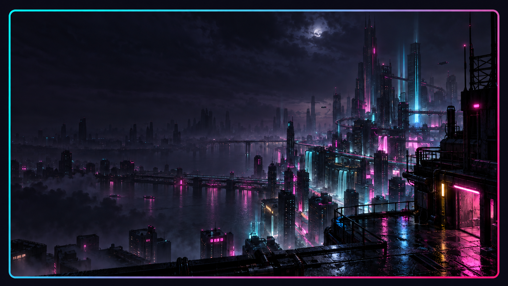

# Neon District

A cyberpunk Omarchy theme: near-black violet, electric cyan, hot pink, and pale lavender text. Includes a custom rainy city wallpaper.



*Styled wallpaper preview illustrating the gradient window border. Theme accents: electric cyan `#36f9f6`, hot pink `#ff4f9a`, and near-black violet `#0b0914`.*

Install by copying this directory to `~/.config/omarchy/themes/neon-district`, then run `omarchy theme set neon-district`.

## Lock screen and terminal prompt

The theme includes cyan lock-screen text, a pink password border, and yellow error feedback. With Lock Explorer's **Editorial** layout, this gives an oversized cyan clock over the city wallpaper. The stock lock screen also uses these colors; layout depends on your lock plugin.

An optional Starship prompt is included at `extras/starship.toml`: cyan paths, pink Git branches/status, and yellow command-error indicators. It uses terminal ANSI colors, so it adapts when you switch themes. Back up your existing prompt before installing:

```bash
cp ~/.config/starship.toml ~/.config/starship.toml.bak.$(date +%s)
cp extras/starship.toml ~/.config/starship.toml
```

The prompt appears on the next shell prompt redraw. Installing the theme alone does not replace your Starship configuration.

Previous theme on the original machine: `custom`. Restore with `omarchy theme set custom`.

Wallpaper generated with the built-in image generation tool. Prompt:

Use case: stylized-concept. Asset type: ultrawide Linux desktop wallpaper, landscape 16:9, high resolution. Create a sophisticated cyberpunk city at midnight seen from a quiet elevated rooftop, rain-slick architecture and distant dense megastructures, sparse electric cyan and hot magenta light reflected on wet surfaces, deep near-black violet shadows, atmospheric haze, cinematic detailed digital matte painting. Keep upper third and left half subdued and uncluttered for desktop windows, concentrate architectural interest toward lower right, restrained glow rather than blown-out neon. Palette #0b0914 #151023 #36f9f6 #ff4f9a with tiny acid yellow accents. No text, no lettering, no logos, no watermarks, no borders.

Border preview generated with the built-in image tool from the original wallpaper. Edit prompt: Add a thin rounded cyan `#36f9f6` to pink `#ff4f9a` diagonal gradient frame with a near-black violet margin; preserve the city composition, with no title bar, controls, or text.
